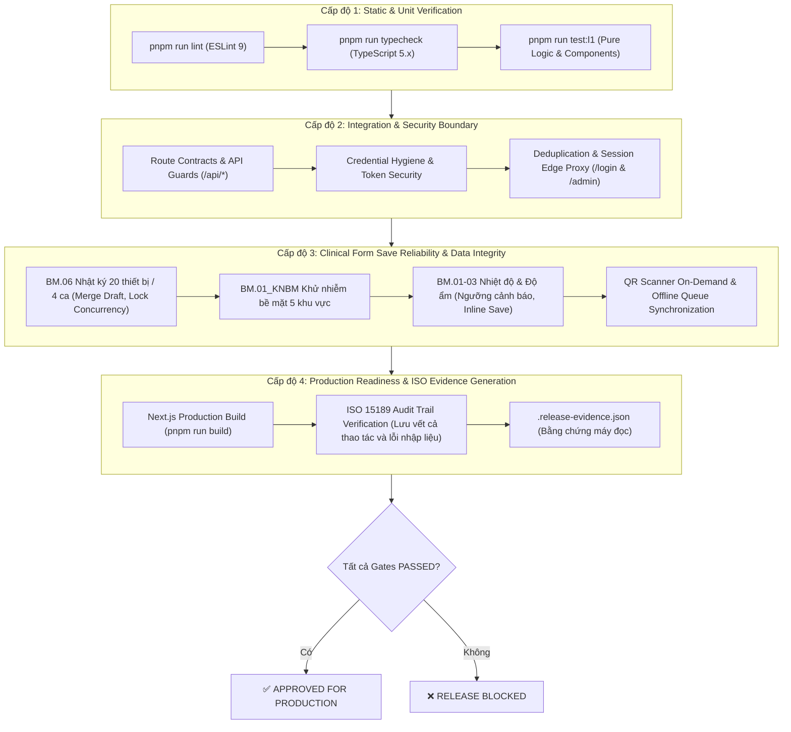

# QUY CHUẨN KIỂM THỬ 4 CẤP ĐỘ & CƠ CHẾ RELEASE GATE
## Khoa/Bộ môn Sinh Hóa — Bệnh viện Quân y 103
**Tiêu chuẩn chất lượng:** ISO 15189:2022  
**Mục tiêu:** Đảm bảo toàn bộ mã nguồn trước khi tích hợp vào nhánh `master` hoặc đưa lên môi trường Production đều phải vượt qua 4 cấp độ kiểm thử độc lập, có bằng chứng máy đọc `.release-evidence.json` được ký vết theo từng commit hash.

---

## 1. Kiến Trúc 4 Cấp Độ Kiểm Thử (4-Level Quality Gates)



---

## 2. Chi Tiết Từng Cấp Độ Kiểm Thử

### Cấp độ 1 (Level 1) — Static Analysis & Unit/Component Verification
- **L1.1 ESLint (`pnpm run lint`)**: Đảm bảo không có biến chưa sử dụng, không vi phạm rules of hooks, không import sai quy chuẩn.
- **L1.2 TypeScript Typecheck (`pnpm run typecheck`)**: Chạy `tsc --noEmit` với `strict: true`. Bắt buộc 100% type safety, không cho phép ép kiểu lỏng lẻo gây crash runtime.
- **L1.3 Unit & Component Tests (`pnpm run test:l1`)**:
  - Kiểm tra các hàm nghiệp vụ thuần: format ngày giờ Việt Nam (`Asia/Ho_Chi_Minh`), phân loại ca trực (`SHIFT_1` – `SHIFT_4`), tính toán tiến độ 4 ca.
  - Kiểm tra visual components độc lập: Shell, Navigation, Buttons, Badge, Sanitize search queries.

### Cấp độ 2 (Level 2) — Integration & Security Boundary
- **Bảo mật thông tin đăng nhập & Vệ sinh mã nguồn (`tests/credential-hygiene.test.ts`)**: Quét toàn bộ codebase để đảm bảo không hardcode mật khẩu, JWT, service role keys hoặc API secret vào commit.
- **Bảo vệ Endpoint API (`tests/quick-save-route.test.ts`, `tests/admin-staff-routes.test.ts`)**:
  - `middleware.ts` không bao giờ chuyển hướng `/api/*` sang `/login` (tránh HTTP 405 Method Not Allowed trên các request POST).
  - Trả về mã lỗi HTTP chuẩn: 401 Unauthorized, 403 Forbidden, 400 Bad Request, 409 Conflict.
- **Tối ưu hóa phiên làm việc & Hiệu năng điều hướng (`tests/nav-perf-and-auth.test.ts`)**:
  - Deduplicate session check ở Edge proxy, chỉ query bảng `profiles` với các route `/admin/*`.
  - Bọc `getCurrentAccess()` bằng `React.cache()` để deduplicate giữa các Server Components.

### Cấp độ 3 (Level 3) — Clinical Form Save Reliability & Data Integrity (ISO 15189)
- **Quy tắc vàng:** Tuyệt đối không bao giờ hiển thị "Đã lưu" hoặc "Bình thường" nếu máy chủ backend chưa trả về HTTP 200 / RPC thành công.
- **Vòng đời 5 trạng thái:** `idle` ➔ `dirty` ➔ `saving` ➔ `saved` (hoặc `error_pending_sync`).
- **Phòng chống mất dữ liệu khi mất kết nối:**
  - Fallback lưu ngay vào `localStorage` kèm timestamp ISO.
  - Hàng đợi offline (`offlineQueue`) tự động đồng bộ khi mạng phục hồi.
  - Giữ nguyên dữ liệu người dùng nhập trên màn hình khi xảy ra lỗi mạng hoặc lỗi kiểm tra, hiển thị nút "Thử lại".
- **Biểu mẫu BM.06 (Nhật ký 20 thiết bị):**
  - Đồng bộ số lượng 20 máy hoạt động giữa giao diện người dùng, route `/api/forms/bm06`, và RPC database `save_equipment_shift_draft`.
  - Hỗ trợ hợp nhất (merge) dữ liệu draft khi hoàn tất ca trực: Kỹ thuật viên nhập liệu theo từng khu vực vẫn có thể chốt hoàn tất ca mà không bị thiếu máy.

### Cấp độ 4 (Level 4) — Production Readiness & Machine-Readable Evidence
- **Next.js Production Build (`pnpm run build`)**: Biên dịch toàn bộ ứng dụng sang bundle tĩnh và server functions, tối ưu hóa bundle size và tree-shaking.
- **Nhật ký kiểm toán ISO 15189 toàn diện (`audit_events`)**:
  - Ghi nhận bất biến mọi thao tác lâm sàng: lưu ca, phê duyệt, xuất báo cáo.
  - **Lưu vết cả lỗi nhập liệu:** Khi kỹ thuật viên nhập ngoài dải đo, thiếu máy, hoặc xung đột phiên bản, hệ thống ghi nhận `BM06_ENTRY_ERROR` hoặc `MEASUREMENT_ENTRY_ERROR` để lãnh đạo khoa và QA đối soát nguyên nhân.
- **Bằng chứng máy đọc `.release-evidence.json`**:
  - Tự động sinh file JSON chứa thông tin commit, timestamp, kết quả kiểm thử của từng gate và phán quyết `verdict: "APPROVED" | "REJECTED"`.

---

## 3. Cấu Trúc Schema Bằng Chứng Máy Đọc (`.release-evidence.json`)

```json
{
  "schemaVersion": "1.0.0",
  "system": "SH103-Lab Clinical Information Management",
  "hospital": "Bệnh viện Quân y 103 - Học viện Quân y",
  "department": "Bộ môn - Khoa Sinh Hóa",
  "standard": "ISO 15189:2022",
  "generatedAt": "2026-10-27T09:05:00.000Z",
  "verdict": "APPROVED",
  "git": {
    "branch": "master",
    "commitHash": "b19fc0a2031675d598204eb7c9f07d98fcd88c3c",
    "commitShort": "b19fc0a",
    "commitMessage": "Merge pull request #14 from namvuhvqy/perf/on-demand-qr-scanner",
    "commitAuthor": "namfive <namvuhvqy@gmail.com>",
    "isClean": true
  },
  "summary": {
    "totalGates": 6,
    "passedGates": 6,
    "failedGates": 0,
    "durationTotalSeconds": 48.2
  },
  "gates": [
    {
      "level": "L1",
      "name": "L1.1 ESLint & Code Hygiene",
      "status": "PASSED",
      "durationSeconds": 3.4
    },
    {
      "level": "L1",
      "name": "L1.2 TypeScript Static Type Safety",
      "status": "PASSED",
      "durationSeconds": 4.1
    },
    {
      "level": "L2",
      "name": "L2 Integration & Route Security Gate",
      "status": "PASSED",
      "durationSeconds": 5.2
    },
    {
      "level": "L3",
      "name": "L3 Clinical Form Save Reliability & Data Integrity Gate",
      "status": "PASSED",
      "durationSeconds": 6.8
    },
    {
      "level": "L1",
      "name": "L1.3 Complete Test Suite Coverage",
      "status": "PASSED",
      "durationSeconds": 14.5
    },
    {
      "level": "L4",
      "name": "L4 Production Build Gate",
      "status": "PASSED",
      "durationSeconds": 14.2
    }
  ]
}
```

---

## 4. Hướng Dẫn Vận Hành Release Gate

### Kiểm tra cục bộ trước khi tạo Pull Request
```bash
# 1. Chạy toàn bộ 4 cấp độ kiểm thử và xuất bằng chứng máy đọc
pnpm run release:evidence

# 2. Kiểm tra file kết quả
cat .release-evidence.json
```

### Kiểm tra tự động trên GitHub Actions (CI)
- Mỗi khi có commit đẩy lên nhánh `master`, `main`, `perf/*`, `fix/*`, hoặc PR hướng về `master`, quy trình CI trong `.github/workflows/ci.yml` sẽ tự động thực thi các bước:
  1. `pnpm run lint`
  2. `pnpm run typecheck`
  3. `pnpm run test`
  4. `pnpm run build`
  5. `pnpm run release:evidence`
  6. Tự động đóng gói và đính kèm `.release-evidence.json` vào Artifacts của CI Pipeline.
